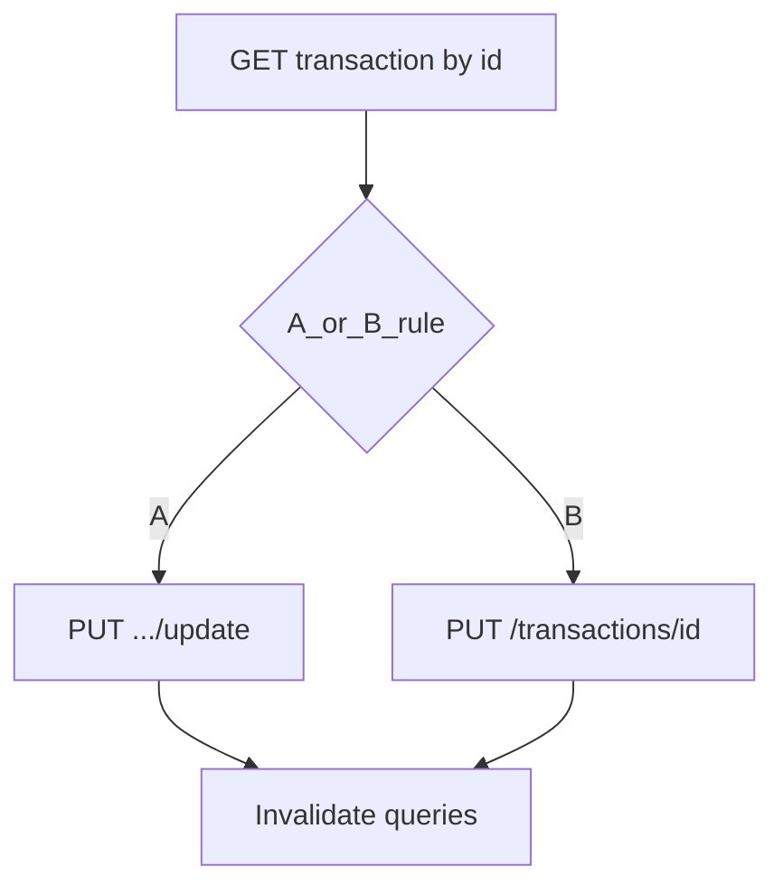

# План: вкладка History, список и деталь транзакции (актуализировано под спецификацию)

> Спецификация: [frontend-backend-spec.en.md](../frontend-backend-spec.en.md) (§4.3–4.4), [receipt-scan-backend.en.md](../receipt-scan-backend.en.md) — `PUT .../update` для черновиков и **уже подтверждённых** многострочных транзакций.

## Контекст по коду

- Табы сейчас: три экрана в `app/(tabs)/_layout.tsx` (`index`, `add`, `profile`). Нужен порядок: **Home, Add, History, Profile**.
- Переключатель месяца — `features/home/ui/MonthSwitcher.tsx` + `useSelectedMonth` / `useHomeStore`. Переиспользовать как есть, чтобы месяц на главной и в истории совпадал.
- Роуты `(add)` в корневом `app/_layout.tsx` вне `Tabs` — при переходе на `/(add)/manual` таб-бар скрывается (стандартное поведение Expo Router). Фраза «панель на всех страницах» — **четыре вкладки на корневых таб-экранах**; глобальный таб-бар на стеке `(add)` — отдельная перестройка.

## 1. Навигация: 4 кнопки

- В `app/(tabs)/_layout.tsx` добавить `<Tabs.Screen name="history" ... />` **между** `add` и `profile`.
- Иконка списка: новая пара SF Symbol → Material Icons в `shared/ui/IconSymbol.tsx`.
- i18n: `nav.history`, `history.title`, строки пагинации и т.д.

## 2. Маршруты истории: список + деталь в одном табе

- `app/(tabs)/history/_layout.tsx` — `Stack` с теми же опциями хедера, что у табов.
- `history/index.tsx` — список.
- `history/[id].tsx` — деталь / редактирование.

## 3. Дизайн из Stitch (MCP)

- `list_projects` → `list_screens` → экран **«Updated Transaction History»** → `get_screen` (screenshot / html как референс).
- Заголовок экрана только в навигационном хедере (`Stack.Screen` `options.title`), не дублировать крупный title в контенте.

## 4. Экран списка

- `MonthSwitcher` под хедером.
- Список трат с группировкой по дате; клик → `router.push` на `/history/[id]`.
- Пагинация внизу; при смене месяца сбрасывать страницу на 1.
- Данные: `GET /api/transactions` с `from` / `to` по выбранному месяцу + `per_page` / `page` (уточнить по фактическому JSON пагинации Laravel).

## 5. API и фича-слой (`features/transactions` + существующий receipt update)

### 5.1 Список и загрузка одной транзакции

| Файл | Назначение |
|------|------------|
| `api/getTransactions.ts` | `GET /api/transactions?from&to&type&per_page&page` |
| `api/getTransaction.ts` | `GET /api/transactions/{id}` — для экрана детали (в т.ч. `items` + `category`) |

Индекс истории по-прежнему только подтверждённые (`confirmed_at IS NOT NULL` на бэкенде).

### 5.2 Обновление: два пути (по обновлённой спецификации)

**Правило ветки A vs B (зафиксировать в коде, без «receipt-like» на глаз):**

- **Ветка A** (`PUT .../update`): если `items.length > 1` **или** `created_by === 'ai'` **или** `img_path` задан (чек/скан, в т.ч. одна строка).
- **Ветка B** (`PUT /api/transactions/{id}`): если **одна** строка **и** `created_by === 'user'` (классический ручной расход из manual).

Так однострочный AI-черновик / подтверждённый чек не уйдёт по пути B, а однострочный ручной не будет зря тащить полный `items[]` при сохранении через простой PUT.

**Порядок в коде:** сначала проверять условия **A**; только если ни одно не выполнено и при этом `items.length === 1` и `created_by === 'user'` — **B** (иначе однострочный ручной с `img_path` уйдёт в A, а не ошибочно в B).

**A. `PUT /api/transactions/{transaction}/update`**

- Тело `date` + **`items[]`** (полная синхронизация строк, опционально `id` на строке; сервер пересчитывает `total_amount`).
- Поведение бэкенда (см. `receipt-scan-backend.en.md`, `updateReceipt`): черновик — при первом успешном сохранении выставляется `confirmed_at`; у **уже подтверждённой** транзакции строки обновляются, **`confirmed_at` не меняется**.
- Фронт: `updateReceiptTransaction` ([`features/receipt-scan/api/updateReceiptTransaction.ts`](../../features/receipt-scan/api/updateReceiptTransaction.ts)), тот же payload, что на [`app/(add)/scan-review.tsx`](../../app/(add)/scan-review.tsx).

**B. `PUT /api/transactions/{id}`**

- Тело по §4.3 (`total_amount`, `date`, `type`, `category_id` — уточнить по контроллеру).
- UI как `manual.tsx` только для ветки B.

## 6. Экран детали (`history/[id].tsx`)

- Стандартный Stack header + title; [`BackButton`](../../shared/ui/BackButton.tsx) как на [`manual`](../../app/(add)/manual.tsx) / [`scan-review`](../../app/(add)/scan-review.tsx).
- Контент:
  - **ветка A:** `ScanReviewSummaryCard`, `ReceiptReviewLineItemsList`, `TransactionDateField` и т.д. — как `scan-review`, но **одна** нижняя кнопка «Обновить» (без «Отменить обзор»).
  - **ветка B:** `AmountInput`, `TransactionDateField`, `CategoryGrid` — как `manual`.
- Хук уровня экрана: загрузка по `id`, инициализация формы / store из ответа `GET`, мутация с выбором **A** или **B** из §5.2, инвалидация списка транзакций и при необходимости summary-запросов главной.

## 7. Диаграмма потока сохранения

## 8. Порядок работ

1. Иконка + i18n + 4-я вкладка в `_layout.tsx`.
2. MCP Stitch: референс списка / пагинации.
3. `getTransactions` + `getTransaction` + хуки списка (пагинация, месяц).
4. Stack `history` + навигация на деталь.
5. Экран детали с ветвлением **PUT .../update** vs **PUT /{id}** по §5.2 и одной кнопкой сохранения.

## Todos

- [ ] Вкладка history, `nav.history`, маппинг иконки в `IconSymbol`, ключи `history.*` в локалях
- [ ] Stitch: `get_screen` для «Updated Transaction History» — вёрстка списка без хедера Stitch
- [ ] `getTransactions`, `getTransaction`, React Query + пагинация и месяц
- [ ] `history/[id]`: ветвление по правилу §5.2 (A: `items.length > 1` или `created_by === 'ai'` или `img_path`; B: одна строка и `created_by === 'user'`)
